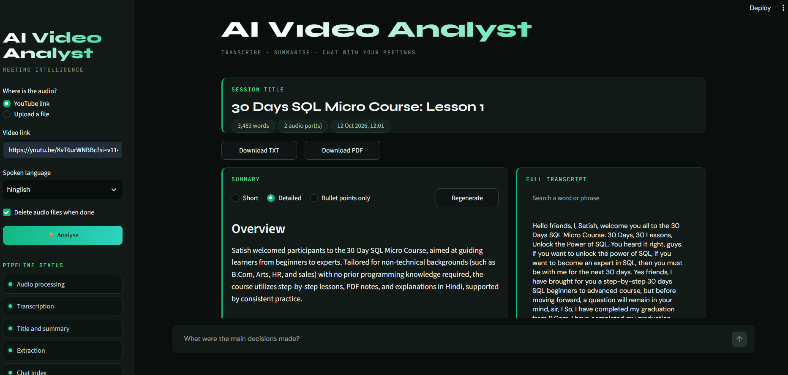
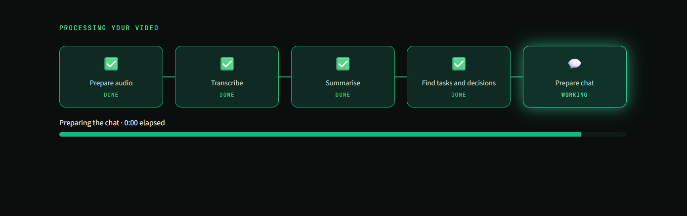
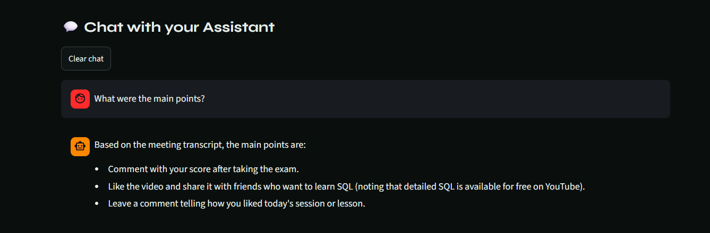
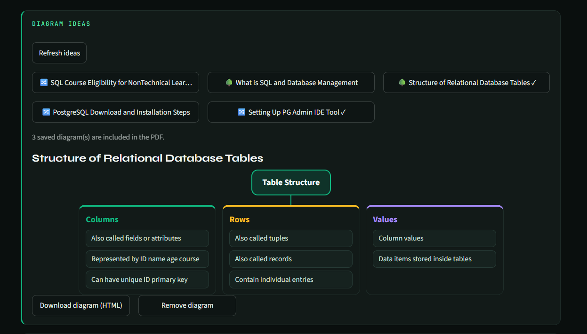

# 🎙️ AI Video Analyst

**Paste a YouTube link or upload a recording. Local Whisper transcribes it, Gemini summarises it and pulls out action items and decisions, and you can chat with the transcript.**


## 🖼️ Application preview

| Home | Pipeline running |
|------|------------------|
|  |  |

| Chat with sources | Diagrams |
|-------------------|----------|
|  |  |

## ✨ Overview

AI Video Analyst turns a video or meeting recording into notes you can search. You give it a link or a file, and a pipeline of steps does the rest:

| Step | Component | What it does |
|------|-----------|--------------|
| 01 | **Audio Processor** | Downloads audio with yt-dlp (or converts an uploaded file with ffmpeg) and splits it into 10-minute chunks |
| 02 | **Transcriber** | Transcribes each chunk locally with OpenAI Whisper, so no audio leaves your computer |
| 03 | **Summarizer** | Writes a title and a summary with a map-reduce LCEL chain on Gemini |
| 04 | **Extractor** | Pulls out action items, key decisions and open questions |
| 05 | **RAG Engine** | Stores the transcript in ChromaDB with HuggingFace embeddings, so you can ask questions about it |

### Features

- Works with **YouTube links** and **uploaded files** (mp3, wav, m4a, mp4, mkv, webm, ogg, flac)
- **Local transcription**, with English and Hinglish support
- **Summary styles:** short, detailed or bullet points
- **Action items, key decisions and open questions** extracted automatically
- **Chat with the transcript**, with the matching passages shown under each answer
- **Study tools:** diagrams (flow, tree, comparison), quiz and flashcards
- **Saved meetings** that reopen without transcribing again
- **Export** the results as TXT or PDF

## 🏗️ Architecture

```
YouTube link / file ──► Audio Processor ──► Transcriber ──► Summarizer ──► Extractor
                        (yt-dlp, ffmpeg,    (Whisper,       (LCEL +        (LCEL +
                         10-min chunks)      runs locally)   Gemini)        Gemini)
                                                  │
                                                  ▼
                                            RAG Engine ──► Chat with your meeting
                                            (ChromaDB + HuggingFace embeddings)
```

- **Summarizer and extractor** are LCEL pipelines: `prompt | llm | StrOutputParser()`.
- **Long transcripts** are split into chunks, each chunk is summarised, and the partial summaries are combined into one final summary.
- **RAG chain** retrieves the 4 most relevant transcript passages and answers only from them.
- **LLM:** Google Gemini through `langchain-google-genai`, using a free API key.

## 🛠️ Tech Stack

- **Language:** Python 3.12
- **Orchestration:** LangChain, LCEL (Runnables)
- **Speech-to-text:** OpenAI Whisper (local)
- **LLM:** Google Gemini
- **Vector store and embeddings:** ChromaDB, HuggingFace sentence-transformers
- **Audio:** yt-dlp, pydub, ffmpeg
- **Export:** fpdf2
- **UI:** Streamlit
- **Config:** python-dotenv

## 📁 Project Structure

```
AI-Video-Analyst/
├── main.py                 # Terminal version of the pipeline
├── core/
│   ├── transcriber.py      # Whisper transcription
│   ├── summarizer.py       # Title and summary chains
│   ├── extractor.py        # Action items, decisions, questions
│   ├── rag_engine.py       # RAG chain and question answering
│   └── vector_store.py     # ChromaDB store and retriever
├── utils/
│   └── audio_processor.py  # Download, convert and chunk audio
├── assets/                 # Screenshots used in this README
├── requirements.txt        # Dependencies
├── .gitignore
└── README.md
```

## ⚙️ Run Locally

### 1. Install ffmpeg

ffmpeg is needed to download and convert audio. It is not a Python package, so install it on your system:

```bash
winget install Gyan.FFmpeg      # Windows
# brew install ffmpeg           # macOS
# sudo apt install ffmpeg       # Linux
```

Close the terminal, open a new one, and check it with `ffmpeg -version`.

### 2. Clone the repository

```bash
git clone https://github.com/Khushi18Singh/AI-Video-Analyst.git
cd AI-Video-Analyst
```

### 3. Create a virtual environment and install dependencies

Using **uv**:

```bash
uv venv --python 3.12
.venv\Scripts\activate        # Windows
# source .venv/bin/activate   # macOS / Linux
uv pip install -r requirements.txt
```

Or using **pip**:

```bash
python -m venv .venv
.venv\Scripts\activate        # Windows
# source .venv/bin/activate   # macOS / Linux
python -m pip install -r requirements.txt
```

### 4. Add your API key

Create a `.env` file in the project root:

```env
GOOGLE_API_KEY=your_gemini_api_key
```

- Gemini API key (free tier): [aistudio.google.com](https://aistudio.google.com)

### 5. Run the pipeline

```bash
python main.py
```

You will be asked for a YouTube link or a file path, and the spoken language (`english` or `hinglish`). The title, summary, action items, key decisions and open questions are printed, and then you can chat with the meeting. Type `exit` to quit.

The first run downloads the Whisper `small` model (about 460 MB) and the embedding model. This happens only once.

## ⚠️ Known Limitations

- Whisper runs on the CPU, so transcription is slow. A 10-minute chunk can take several minutes, and the `small` model needs about 2 GB of RAM. Try short videos first.
- The free Gemini tier has rate limits, so you may see `429` errors. Waiting a minute and retrying usually fixes it.
- Google retires old Gemini models over time. If you get a `404 model not found` error, change the model name in the `get_llm()` function.
- Some YouTube videos block downloads or need a JavaScript runtime for yt-dlp. The warning about it can be ignored unless a download fails.
- Summary and answer quality depend on the transcript quality and on the free-tier model.

## 🔮 Future Improvements

- Timestamps in the transcript
- Faster transcription with GPU support
- Speaker labels
- Transcript caching, so the same video is never transcribed twice
- More languages
- Deploy the web interface online

## 👩‍💻 Developer

**Khushi Singh**

I am Khushi Singh, an aspiring AI engineer and Generative AI learner. I enjoy building practical projects with Python, LangChain and Streamlit, and AI Video Analyst is one of them. I am learning by building, and I am open to feedback and new ideas.

If you like this project, give it a ⭐ on GitHub.